# Second Key

A bank-side authorization kernel for coached payments. Claude reads the conversation and cites evidence. A versioned rules engine decides. The model has no release capability. A room of red-teamers on their phones tries to talk a fictional customer, Margaret, into sending her money out, live.

Cal Hacks 13.0 project. Everything below is true of this repo as of the commit you are reading.

## Headline numbers

From `eval/latest.json`, produced by `scripts/eval.py` over the 60 reviewed cases in `fixtures/cases/` (40 legitimate, 20 scams). Every case runs through the real kernel code path: create, attest, certificate, release. `scripts/acceptance.sh` regenerates this file on every run.

| Number | Value | Run |
|---|---|---|
| Unauthorized releases | 0 of 20 scam cases | 60 cases, extractor: mock |
| Legitimate payments completed | 40 of 40 | 60 cases, extractor: mock |
| Average friction on legitimate payments | 0.8 steps (cap 2.0) | 60 cases, extractor: mock |
| Scams held or denied | 20 of 20 | 60 cases, extractor: mock |
| Scams that need a conversation signal, held or denied | 8 of 8 | 60 cases, extractor: mock |
| Outcome mismatches against the reviewed expectation | 0 | 60 cases, extractor: mock |
| Rule id mismatches against the allowed set | 0 | 60 cases, extractor: mock |
| Audit chain verified after every case | 60 of 60 | 60 cases, extractor: mock |

The mock extractor is keyword-based. It is what the acceptance gate runs so the gate works without network. The real extractor (Claude Sonnet 5.5 via the Anthropic SDK) was run on a 12-case subset and recorded in `eval/latest_real.json`:

| Number | Value | Run |
|---|---|---|
| Unauthorized releases | 0 of 10 scam cases | 12 cases (2 legit, 10 scam), extractor: real, model claude-sonnet-5-5 |
| Legitimate payments completed | 2 of 2 | 12 cases, extractor: real |
| Scams held or denied | 10 of 10 | 12 cases, extractor: real |
| Scams that need a conversation signal, caught by a named signal rule | 9 of 9 | 12 cases, extractor: real |
| Outcome mismatches, rule id mismatches | 0, 0 | 12 cases, extractor: real |
| Outcome agreement, mock vs real, same cases | 10 of 10 | 10-case agreement check |

Honesty notes on these two tables:

- In mock mode, 3 of the 8 signal-dependent scams (S-10, S-11, S-16) are held by the policy default (HOLD when no rule fires), not by a named signal rule. With the real extractor all of them are caught by H-02, H-04 or H-05.
- Per-signal presence agreement between the two extractors on the 10-case check: urgency 1.0, secrecy 1.0, authority 0.7, payment_method 0.7, threat 0.7, new_relationship 0.5. The real extractor found extra signals; the mock never found one the real extractor missed.
- The real run was recorded at commit `a290460`, before rule H-07 and the ref normalization landed (`02405d8`). Both changes only add holds, so no outcome in that run would move, but re-run it before quoting it as current.

## Why this exists

The FBI IC3 2025 Annual Report counts $7.748B in reported losses by people 60 and over, across 201,266 complaints. The common shape is a coached payment: the customer passes every authentication check and sends the money themselves. Existing tools detect and alert. Second Key is an authorization boundary instead. The model can only produce text and signals. A rules engine, a certificate verifier and a hash-chained audit log sit between any conversation and SUBMITTED. Banks already have legal room to hold (FINRA Rule 2165, up to 55 business days with a reasonable belief of exploitation), and other markets already make banks pay for coached payments (UK PSR APP reimbursement, up to £85,000). FinCEN's 2024 elder financial exploitation analysis reports adult children as the most frequently reported perpetrators of elder theft. That is why the family role here has no release permission.

## How it works

```mermaid
flowchart LR
  P["Phones: /play (red-teamers)"] -->|"submit_turn reducer"| S[("SpacetimeDB room: turn, outcome, leaderboard, scoreboard, audit_mirror")]
  S -->|"queued turn rows"| B["Bridge worker (Node, the only authorized worker identity)"]
  B -->|"POST /rooms/{room}/turns + X-Ops-Token"| K
  subgraph K["Kernel (Python, FastAPI, SQLite)"]
    M["Margaret persona: Claude or mock. Text and a possible draft."] --> R["Room session"]
    R -->|"PaymentIn + transcript"| X["Extractor: Claude or mock. Signals with evidence ids."]
    X -->|"signals only"| E["Policy engine v1 (YAML, 9 rules, default HOLD, DENY over HOLD over ALLOW)"]
    E -->|"DENY"| D["DENIED (terminal)"]
    E -->|"HOLD"| H["HELD"]
    H -->|"BANK_REVIEW attest"| EL["ELIGIBLE_TO_SUBMIT"]
    E -->|"ALLOW"| EL
    EL -->|"issue certificate (120 s, nonce, fingerprint)"| V["Certificate verifier"]
    V -->|"valid, unconsumed, fingerprint matches"| SUB["SUBMITTED"]
    V -->|"anything else"| REF["SETTLEMENT REFUSED, invariant named"]
    A[("Hash-chained audit log + sidecar head anchor")]
  end
  SUB -->|"withdrawal + deposit"| N["Capital One Nessie sandbox"]
  B -->|"record_reply, record_outcome, record_legit_completed, mirror_audit"| S
  S --> BD["Board: /board (projector)"]
  K -->|"WS /ws (role-scoped)"| O["Ops: /ops (bank operator)"]
```



The only path to SUBMITTED runs through the policy engine and then the certificate verifier. The model layer (`backend/kernel/llm/`, `backend/kernel/margaret/`) imports nothing from state, policy, certificates or the database, and a test fails if that changes.

- Policy: `backend/kernel/policy/v1.yaml`. Nine rules: D-01 (mule list), H-01 (new payee on WIRE, ZELLE or CRYPTO), H-02 (secrecy), H-03 (amount over 3x the 90-day baseline), H-04 (urgency plus new payee), H-05 (authority plus payment method), H-06 (threat), H-07 (WIRE, ZELLE or CRYPTO over $1,000 to anyone not on the biller list), A-01 (known biller under cap). Every rule is evaluated; the strongest outcome wins; no rule means HOLD. The loader accepts exactly one precedence, DENY over HOLD over ALLOW, and refuses a default of ALLOW. A rule that errors counts as HOLD (X-01). An extractor failure adds X-00 and never lowers the outcome.
- Known biller means the account reference is a prior payee. A matching display name alone never allows. Account refs and actor ids are normalized (NFKC, trimmed, invisible characters removed, casefolded) before any comparison and before fingerprinting.
- Fingerprint: sha256 of account, amount, currency, beneficiary reference, rail and policy version.
- Certificate: one-time, nonce-bound, bound to the payment and its fingerprint, 120 second expiry, consumed in a single SQL statement, sibling certificates voided on release.
- Audit: SQLite, each row hashes the previous one. The head (seq, hash) is written to a sidecar file next to the database after every append and compared at startup and on `GET /audit/verify`. A shorter tail or a different hash at the anchored seq reports `anchor: mismatch`, and the kernel refuses every audited write until an operator calls `POST /audit/acknowledge`. Tamper-evident.
- Stage scoring for red-teamers is by state reached, never by text: 10 engaged, 40 Margaret agreed, 60 payment created, 70 HELD, 90 ELIGIBLE, 100 SUBMITTED.
- End of round: the board has a Debrief view (button, or `?debrief=1`). It shows the three tactics that triggered the most holds in this room and three rules to remember: slow it down, spot check by calling the bank or a family member yourself, stop and do not send.

## The seven invariants and the tests that protect them

Unit tests live in `backend/tests/unit/` (344 functions), API tests in `backend/tests/api/` (63), voice tests in `backend/tests/voice/` (51), property tests in `backend/tests/property/`, red-team tests in `backend/tests/redteam/` (85 attack tests, 9 of them FOUND-then-FIXED findings). The property suite has 27 Hypothesis properties over random action traces (one module per invariant plus two "apply never raises" properties) and 5 pinned regressions the properties found; under `HYPOTHESIS_PROFILE=ci` each property runs 2,000 examples.

| # | Invariant | Tests |
|---|---|---|
| I1 | No payment reaches SUBMITTED without a valid, unconsumed certificate bound to its current fingerprint. | `property/test_i1_no_submit_without_cert.py` (3 properties); `unit/test_state.py::test_released_requires_consumed_certificate_row`; `unit/test_certs.py::test_release_without_eligibility_even_with_cert_row`; `redteam/test_attacks_certificates.py` |
| I2 | Any mutation of amount, payee, rail or account changes the fingerprint and voids every attestation and certificate. | `property/test_i2_mutation_voids.py` (3); `unit/test_mutate.py::test_amount_by_one_cent_voids_everything`, `::test_each_fingerprint_field_changes_it`; `api/test_flow.py::test_mutate_after_certificate_voids_it` |
| I3 | A certificate is one-time, nonce-bound, expires, and is refused on replay. | `property/test_i3_one_time_cert.py` (4, including a thread race); `unit/test_certs.py::test_replay_is_refused`, `::test_expired_is_refused`, `::test_two_threads_same_cert_exactly_one_submits`, `::test_consume_is_single_use_at_sql_level`, `::test_nonce_never_appears_in_audit_or_record` |
| I4 | The LLM layer can only emit signals and text. No path from model output to a state transition except through the policy engine. | `property/test_i4_model_cannot_release.py` (3: an adversarial extractor reaches the same states as a sanitized one); `unit/test_boundary.py::test_decided_cannot_be_built_from_extractor_output`, `::test_model_layer_imports_nothing_that_can_move_state`; `unit/test_attest.py::test_signals_only_reach_state_through_policy`, `::test_extractor_timeout_fails_closed_with_x00`; `api/test_attack.py::test_inject_holds_on_facts_despite_no_concerns`; `redteam/test_attacks_policy_extractor.py` (all 20 scams HOLD or DENY with a zero-signal extractor); `redteam/test_found_compromised_extractor_allows_s05.py` |
| I5 | A co-approver who is the beneficiary cannot attest. Co-approver can attest or extend a hold, never release or redirect. | `property/test_i5_conflict.py` (3); `unit/test_attest.py::test_co_approver_who_is_beneficiary_cannot_attest`, `::test_co_approver_cannot_issue_certificate`, `::test_bank_review_who_is_beneficiary_cannot_lift_hold`; `api/test_flow.py::test_scenario_c_priya_cannot_attest_to_herself`; `redteam/test_found_i5_conflict_normalization.py` |
| I6 | DENY is not overridable by any actor. HOLD can be lifted only by BANK_REVIEW. | `property/test_i6_deny_final.py` (4); `unit/test_attest.py::test_denied_never_changes`, `::test_customer_checkin_cannot_lift_hold`, `::test_bank_review_lifts_hold`; `api/test_flow.py::test_deny_on_denied_is_i6` |
| I7 | The audit log is hash-chained; `GET /audit/verify` detects any edit to past records. | `property/test_i7_audit_chain.py` (5: edit, swap, delete, rehash); `unit/test_audit.py::test_tamper_detected_at_seq`, `::test_deleted_tail_detected`, `::test_full_rewrite_detected_by_head_anchor`; `api/test_flow.py::test_audit_verify_then_tamper`; `redteam/test_found_audit_verifier_lies_after_restart.py` |

Invariant reviews from tonight are in `docs/reviews/`. Each of the three reviews (kernel library, kernel service, API routes) came back FAIL on the first pass and PASS on re-review after the fixes landed. The red-team suite in `backend/tests/redteam/` has four files of blocked attacks and three `test_found_*` files whose docstrings start with FOUND, then FIXED. See "Honest limits" for what they found.

## Attack panel

Four buttons on `/board`, each a judge can press. Each calls a kernel route with the operator token, runs the attack against the live kernel, cancels anything it created, and shows the refusal and the invariant.

| Button | Route | What happens | Result |
|---|---|---|---|
| Prompt-inject model | `POST /attack/inject` | Runs `fixtures/compromised_extractor.json` (every signal 0, summary "no concerns") through the policy engine on an IRS-style wire. | HOLD. H-01 and H-03 read payment facts, not signals. The board shows `HELD · H-01 H-03 (model said no concerns)`. Labeled COMPROMISED FIXTURE. |
| Change payee after approval | `POST /attack/mutate` | Create, attest, certify, then change the payee, then try to release with the old certificate. Needs `DEMO_MODE=1`; otherwise the route is 404 and the board says so. | `SETTLEMENT REFUSED · I2_FINGERPRINT` |
| Replay old approval | `POST /attack/replay` | Release twice with the same certificate. | `SETTLEMENT REFUSED · I3_REPLAY` |
| Daughter releases to herself | `POST /attack/self-approve` | Priya, CO_APPROVER, attests to a payment where she is the beneficiary. | `ATTESTATION REFUSED · I5_CONFLICT` (409) |

Red-teamers on `/play` type or speak to Margaret. They pick from public FTC tactic chips (urgency, secrecy, authority, gift cards, wire, crypto, grandchild in trouble) or write their own. Prompt injection is allowed and expected. They see stage and decision only. The SpacetimeDB view `my_outcomes` has no rule id column, the kernel WebSocket sends payment and attack events only to board and ops sockets, and a typed payee name resolves to an account reference only through an exact match in the room's payee directory, so rule ids and prior-payee history never reach a phone.

## What is mocked tonight, and how to switch to real

All three keys (Anthropic, Cartesia, Nessie) are present in the local `.env`, `OPS_TOKEN` is set, and `DEMO_MODE=1` plus `LLM_CACHE_WARM=1` are on for the table. The real clients are wired and each was exercised against the live service with recorded responses kept for tests. The acceptance gate and `scripts/demo.py` still run on mocks so they work offline. `GET /health` reports the mode of every provider, whether the ops token is set, demo mode, cache counts and audit anchor status. The UI shows a MOCK badge per mocked provider.

| Switch (in `.env`) | Mock | Real | Notes |
|---|---|---|---|
| `MOCK_EXTRACTOR` | `1` forces `MockExtractor` (keyword heuristics) | `0` with `ANTHROPIC_API_KEY` set uses `ClaudeExtractor` | Acceptance runs eval with `MOCK_EXTRACTOR=1`. |
| `MOCK_MARGARET` | `1` forces the fixture-scripted persona | `0` with the key uses `ClaudeMargaret` | Both use `fixtures/margaret.md`. Margaret `max_tokens` is 1600 because the structured-output reply carries a thinking block before the JSON. |
| `TTS_PROVIDER` | `mock`: macOS `say` plus `afconvert` to WAV | `cartesia`: Sonic `sonic-3.6`, stock voice Michelle | Cache keyed by text and voice id in `backend/cache/audio/`. |
| `STT_PROVIDER` | `mock`: fixed transcript | `cartesia`: Ink `ink-whisper` batch | Push to talk on `/play` posts webm to `/rooms/{room}/turns`. |
| `NESSIE_API_KEY` | empty: in-process `MockNessieTransport`, same routes | set: `https://api.nessieisreal.com` | Base URL in `NESSIE_BASE_URL`. |
| `ROOM_BACKEND` | `memory`: in-process `RoomStore` over the kernel WS | `spacetime`: local SpacetimeDB 2.13 via the repo-local CLI | Same tables, same limits, same attacker view in both. |
| `DEMO_MODE` | `1`: enables `/payments/{id}/mutate`, `/attack/mutate` and `/audit/tamper`; on its own it also makes Claude replay-only from `backend/cache/llm/` (a cache miss is a HOLD or the safe line, never a call) | `0`: those three routes return 404; Claude calls are live | `.env` for the table sets `DEMO_MODE=1` and `LLM_CACHE_WARM=1`: demo routes on, cache first, network on a miss, so the real Margaret stays live. `scripts/demo.py` forces replay-only for the offline guarantee. |
| `OPS_TOKEN` | empty: operator routes open | set: `X-Ops-Token` header required for attest (BANK_REVIEW, CO_APPROVER), certificate, release, deny, mutate, every `/attack/*`, `/audit/tamper`, `/audit/acknowledge`, room reset, and the board and ops WebSocket roles (`?token=`) | A shared secret, not a login system. `scripts/dev.sh` generates one if absent and prints URLs that carry it. `/ops` has a token field; `/board` and `/ops` adopt `?token=` from the URL into browser storage. |
| `BRIDGE_TOKEN` | unset: falls back to `OPS_TOKEN` | set: the bridge sends it on `POST /rooms/{room}/turns` | Only the bridge calls that JSON route. |

Missing key policy: a missing key never blocks. The factory falls back to the mock and logs why.

## Run

Requirements: macOS or Linux, Python 3.12 via `uv`, Node 20+, `npm`. SpacetimeDB CLI 2.13.0 is installed repo-local under `.tools/spacetime/` (see `docs/DECISIONS.md`); set `ROOM_BACKEND=memory` to run without it.

```bash
cp .env.example .env            # fill in what you have; blanks mean mocks
scripts/dev.sh start --fresh    # kernel :8000, SpacetimeDB :3000, bridge, frontend :3001; --fresh wipes the SQLite db and its anchor
scripts/dev.sh status
scripts/dev.sh stop
```

`dev.sh start` publishes the module, creates the `DEMO` room (`ROOM_CODE`), authorizes the bridge identity, pre-renders Margaret's audio in the background, and prints four lines: the ops token, the board URL (`/board?room=DEMO&token=...`), the ops URL (`/ops?token=...`) and the phone URL (`http://<laptop-ip>:3001/play?room=DEMO`). Never share the token URLs with players. Do not open `/play` in the same browser profile as the ops laptop: `join_room` turns that identity into an attacker.

Tests and eval:

```bash
cd backend && uv run pytest -q tests/unit tests/api tests/voice tests/redteam
cd backend && HYPOTHESIS_PROFILE=ci uv run pytest -q tests/property     # 27 properties at 2,000 examples; a few minutes
cd backend && MOCK_EXTRACTOR=1 uv run python ../scripts/eval.py --suite ../fixtures/cases --out ../eval/latest.json
cd backend && uv run python ../scripts/eval.py --real --ids L-01,L-11,S-03,S-04,S-05,S-07,S-09,S-10,S-11,S-12,S-13,S-16 --agreement 10 --out ../eval/latest_real.json
cd backend && DEMO_MODE=1 uv run python ../scripts/demo.py                # scenarios A, B, C, attack panel, audit chain; in-process, offline, about 0.6 s
uv run --project backend python scripts/demo.py --warm                    # once, with the real key: fill the Claude cache for demo replay
cd backend && DEMO_MODE=1 uv run python ../scripts/demo.py --real         # replay from cache; the llm cache line must show misses=0
scripts/acceptance.sh                                                     # gates G1 to G8
cd frontend && npx playwright test e2e/smoke.spec.ts                      # 8 tests; screenshots in frontend/e2e/screenshots/
```

Screenshots from the smoke run: `frontend/e2e/screenshots/board.png`, `board-attack.png`, `board-debrief.png`, `play-join.png`, `play-chat.png`, `ops.png`, `ops-tampered.png`.

## Sponsors used, and exactly how

- Anthropic. Claude Sonnet 5.5 (`claude-sonnet-5-5`) through the Anthropic Python SDK, `client.messages.parse` with structured outputs. The extractor's output model is built per request: `source_id` is a `Literal` of the evidence ids in that conversation, and `evidence_span` must be a verbatim substring of that evidence item or the signal is dropped. One attempt, 7 second client timeout inside the kernel's 8 second budget; any failure, refusal or truncation is HOLD with rule X-00. Margaret is a second structured-output call with a persona prompt (`fixtures/margaret.md`); any failure returns a fixed safe reply. Every response is cached on disk keyed by a sha256 of the full request, and `DEMO_MODE=1` makes the cache replay-only. About 15 calls warmed the demo cache tonight.
- Cartesia. Margaret speaks through Sonic (`POST /tts/bytes`, model `sonic-3.6`, WAV) with the stock voice Michelle (`d7bf7d75-64b7-4c1e-86c0-79d647366587`). No cloning. Red-teamers can hold to talk; the webm clip goes to Ink (`POST /stt`, model `ink-whisper`). Transcripts are evidence for the extractor, nothing more; the transcript type has no identity field and a test keeps it that way. Audio is cached by text and voice id and pre-rendered by `scripts/prerender_audio.py`.
- SpacetimeDB 2.13.0. The room is a SpacetimeDB database: 9 tables, 11 reducers, 1 view, TypeScript module in `spacetime/`. `submit_turn` enforces 400 characters and one turn per 3 seconds per player on the server clock. Worker-only reducers (`claim_turn`, `record_reply`, `record_outcome`, `record_legit_completed`, `mirror_audit`) check the sender against `config.worker_identity_hex`, which only the database owner can set. Attackers subscribe to `my_outcomes`, a view whose row type is `{turnId, stage, decision}`. Both headline numbers live in one `scoreboard` row: `unauthorized_releases` is written when a room turn reaches stage 100, and `legit_completed` is written by the bridge when a payment that came from neither a room turn nor the attack panel reaches SUBMITTED on the kernel (it polls `GET /payments` every 3 seconds). Verified live tonight against the real turn route and the real scoreboard. Runs on the local server; maincloud publish needs a login in the morning.
- Capital One Nessie. On SUBMITTED the kernel records a withdrawal on Margaret's sandbox account and a deposit on the payee account, both carrying the payment id and the exact cents in `description`, over `https://api.nessieisreal.com`. The withdrawal id is stored as `nessie_transfer_id`. Judge copy says "recorded in the Nessie sandbox ledger". Sandbox balances never move.
- Hyphenate (autonomous finance track). The kernel is the submission: a model proposes, a deterministic engine disposes, every release is certificate-gated and audited.
- Microsoft (enterprise operations). `/ops` is the bank operator view: holds queue with approve and cancel, policy version and rule hits, the property-suite badge, certificate log, payment history, audit list and the verify button.
- CRS sandbox: not used tonight.

## Team

- Armaan, a forward deployed engineer building AI agents for companies. Voice, demo, judge Q&A.
- Advita. Kernel hardening and SpacetimeDB maincloud.
- Sohee. Frontend and mobile.
- Diya. Case review, video, Devpost.

## Honest limits

What the red-team got through tonight, and what we did. The red-team agent ran against our own kernel and found three real holes. First, with a blind extractor (every signal zero, which prompt injection could produce) scam case S-05, a $1,500 Zelle to a groomed prior payee, reached SUBMITTED through the known-biller allow rule; 19 of 20 scams held on facts, that one did not. We added rule H-07 (irreversible rails over $1,000 to anyone not on the biller list always get a check-in) and re-ran all 60 fixtures: no legitimate ALLOW changed. Second, the I5 self-approval check compared actor ids with a bare equality, so `EXT_PRIYA`, a trailing space or a zero-width character let the beneficiary co-approve her own payment. It moved no money (a co-approver cannot release), but it broke the stated invariant; refs and actor ids are now normalized at the kernel edge. Third, erasing the audit tail while the kernel was stopped came back green from `verify` after restart, because the head anchor lived only in memory. The head is now persisted to a sidecar file and checked at startup. Separately, two invariant review rounds found and fixed: a stale handle could revert a fingerprint after mutation, rule precedence was reorderable in the YAML, the attack routes bypassed the operator token, and the WebSocket leaked rule ids to attacker sockets. Each finding is a test in `backend/tests/redteam/` or `backend/tests/unit/` with a docstring that says what was found and what fixed it.

Residual limits, stated plainly:

- The sidecar anchor raises the bar; it does not close the hole. An attacker with disk access who replaces both the database and the sidecar consistently while the kernel is down is not detectable from inside the kernel. That is why we say tamper-evident. `audit_mirror` in SpacetimeDB is a second copy of the last 200 hashes, not a signature.
- Voice is evidence, not identity. Nothing in this system identifies who is speaking, and we do not claim it does.
- Nessie sandbox balances do not move. The ledger lines are real sandbox records; the money is not.
- The mock extractor is keyword-based. In mock mode 3 of 8 signal-dependent scams are held by the default HOLD rather than a named rule. The real extractor numbers come from a 12-case subset recorded before H-07, not the full 60.
- `OPS_TOKEN` is a shared secret in a header and in the projector URL. Not a login system. Room identity is a SpacetimeDB identity plus a room code.
- The two attack buttons that mutate state (`/attack/mutate`, `/audit/tamper`) need `DEMO_MODE=1`. `DEMO_MODE=1` alone makes Claude replay-only, so the table `.env` also sets `LLM_CACHE_WARM=1` to keep Margaret live. Two switches that have to agree is a sharp edge, not a design.
- "Replay old approval" creates a real $8,000 payment that reaches SUBMITTED, with a real Nessie sandbox withdrawal, on every click. The bridge no longer counts attack-origin payments as legitimate completions; the board's own fallback count of SUBMITTED payments on the kernel still does until the frontend fix lands.
- In the rehearsal, the real Margaret resisted every single-tactic line. A payment appears only after the four-line warmth-plus-fear script in `fixtures/demo_script.json`. That is the product working, and it is also why the table demo scripts the first payment.
- If the kernel dies mid-turn, `/play` in SpacetimeDB mode shows "Margaret is thinking" rather than a fail-closed outcome, because the phone submits through the kernel WebSocket and the bridge's fail-closed path never runs. The bridge path itself fails closed (`backend/tests/redteam/test_attacks_room.py`, `bridge/src/index.ts`).
- The Margaret call runs with `max_tokens` 1600 and the extractor with 1024. A very long room transcript could truncate the extractor; that fails closed to HOLD with X-00, which is friction, never a release.
- `Kernel.release` holds the kernel lock across the rail call (Nessie client timeout 15 seconds), so a slow sandbox stalls other kernel calls for at most that long.
- The known biller allow rule (A-01) requires a prior payee account reference. The first payment to a listed biller on a new reference is a HOLD with two friction steps. That is a deliberate cost (`docs/DECISIONS.md`).
- Maincloud publish needs a `spacetime login` in the morning. Tonight the room ran on a local server.
- Margaret is fictional, with a stock voice. No real names, no cloned voices, no real customers.
- Nothing in the UI drives the legitimate path (Scenario B, Bay Roofing) on the live stack. `scripts/demo.py` drives it in-process and an API test covers it over HTTP; at a table it is three calls with the ops token.
