# Second Key

A bank-side authorization kernel for coached payments. Claude reads the conversation and cites evidence. A versioned rules engine decides. The model has no release capability. A room of red-teamers on their phones tries to talk a fictional customer, Margaret, into sending her money out, live.

Cal Hacks 13.0 project. Everything below is true of this repo as of the commit you are reading.

## Headline numbers

From `eval/latest.json`, produced by `scripts/eval.py` over the 60 reviewed cases in `fixtures/cases/` (40 legitimate, 20 scams). Every case runs through the real kernel code path: create, attest, certificate, release.

| Number | Value | Run |
|---|---|---|
| Unauthorized releases | 0 of 20 scam cases | 60 cases, extractor: mock |
| Legitimate payments completed | 40 of 40 | 60 cases, extractor: mock |
| Average friction on legitimate payments | 0.8 steps (cap 2.0) | 60 cases, extractor: mock |
| Scams held or denied | 20 of 20 | 60 cases, extractor: mock |
| Audit chain verified after every case | 60 of 60 | 60 cases, extractor: mock |

The mock extractor is keyword-based. It is what `scripts/acceptance.sh` regenerates so the gate runs without network. The real extractor (Claude Sonnet 5.5 via the Anthropic SDK) was run on a 12-case subset and recorded in `eval/latest_real.json`:

| Number | Value | Run |
|---|---|---|
| Unauthorized releases | 0 of 10 scam cases | 12 cases (2 legit, 10 scam), extractor: real, model claude-sonnet-5-5 |
| Legitimate payments completed | 2 of 2 | 12 cases, extractor: real |
| Scams held or denied | 10 of 10 | 12 cases, extractor: real |
| Scams that need a conversation signal, caught by a named signal rule | 9 of 9 | 12 cases, extractor: real |
| Outcome agreement, mock vs real, same cases | 10 of 10 | 10-case agreement check |

In mock mode, 3 of the 9 signal-dependent scams (S-10, S-11, S-16) are caught by the policy default (HOLD when no rule fires), not by a named signal rule. With the real extractor all 9 are caught by H-02, H-04 or H-05. Per-signal presence agreement between the two extractors on the 10-case check: urgency 1.0, secrecy 1.0, authority 0.8, payment_method 0.7, threat 0.7, new_relationship 0.5. The real extractor found extra signals; the mock never found one the real extractor missed.

## Why this exists

The FBI IC3 2025 Annual Report counts $7.748B in reported losses by people 60 and over, across 201,266 complaints. The common shape is a coached payment: the customer passes every authentication check and sends the money themselves. Existing tools detect and alert. Second Key is an authorization boundary instead. The model can only produce text and signals. A rules engine, a certificate verifier and a hash-chained audit log sit between any conversation and SUBMITTED. Banks already have legal room to hold (FINRA Rule 2165, up to 55 business days with a reasonable belief of exploitation), and other markets already make banks pay for coached payments (UK PSR APP reimbursement, up to £85,000). FinCEN's 2024 elder financial exploitation analysis reports adult children as the most frequently reported perpetrators of elder theft. That is why the family role here has no release permission.

## How it works

```mermaid
flowchart LR
  P["Phones: /play (red-teamers)"] -->|"submit_turn reducer"| S[("SpacetimeDB room: turn, outcome, leaderboard, scoreboard, audit_mirror")]
  S -->|"queued turn rows"| B["Bridge worker (Node, the only authorized worker identity)"]
  B -->|"POST /rooms/{room}/turns"| K
  subgraph K["Kernel (Python, FastAPI, SQLite)"]
    M["Margaret persona: Claude or mock. Text and a possible draft."] --> R["Room session"]
    R -->|"PaymentIn + transcript"| X["Extractor: Claude or mock. Signals with evidence ids."]
    X -->|"signals only"| E["Policy engine v1 (YAML, 8 rules, default HOLD, DENY over HOLD over ALLOW)"]
    E -->|"DENY"| D["DENIED (terminal)"]
    E -->|"HOLD"| H["HELD"]
    H -->|"BANK_REVIEW attest"| EL["ELIGIBLE_TO_SUBMIT"]
    E -->|"ALLOW"| EL
    EL -->|"issue certificate (120 s, nonce, fingerprint)"| V["Certificate verifier"]
    V -->|"valid, unconsumed, fingerprint matches"| SUB["SUBMITTED"]
    V -->|"anything else"| REF["SETTLEMENT REFUSED, invariant named"]
    A[("Hash-chained audit log")]
  end
  SUB -->|"withdrawal + deposit"| N["Capital One Nessie sandbox"]
  B -->|"record_reply, record_outcome, mirror_audit"| S
  S --> BD["Board: /board (projector)"]
  K -->|"WS /ws"| O["Ops: /ops (bank operator)"]
```



The only path to SUBMITTED runs through the policy engine and then the certificate verifier. The model layer (`backend/kernel/llm/`, `backend/kernel/margaret/`) imports nothing from state, policy, certificates or the database, and a test fails if that changes.

- Policy: `backend/kernel/policy/v1.yaml`. Eight rules: D-01 (mule list), H-01 (new payee on WIRE, ZELLE or CRYPTO), H-02 (secrecy), H-03 (amount over 3x the 90-day baseline), H-04 (urgency plus new payee), H-05 (authority plus payment method), H-06 (threat), A-01 (known biller under cap). Every rule is evaluated; the strongest outcome wins; no rule means HOLD. A rule that errors counts as HOLD (X-01). An extractor failure adds X-00 and never lowers the outcome.
- Known biller means the account reference is a prior payee. A matching display name alone never allows.
- Fingerprint: sha256 of account, amount, currency, beneficiary reference, rail and policy version.
- Certificate: one-time, nonce-bound, bound to the payment and its fingerprint, 120 second expiry, consumed in a single SQL statement, sibling certificates voided on release.
- Audit: SQLite, each row hashes the previous one, `GET /audit/verify` reports the first bad sequence number. Tamper-evident.
- Stage scoring for red-teamers is by state reached, never by text: 10 engaged, 40 Margaret agreed, 60 payment created, 70 HELD, 90 ELIGIBLE, 100 SUBMITTED.

## The seven invariants and the tests that protect them

Unit tests live in `backend/tests/unit/`, API tests in `backend/tests/api/`, property tests in `backend/tests/property/`. The property suite has 26 Hypothesis properties over random action traces; under `HYPOTHESIS_PROFILE=ci` each runs 2,000 examples.

| # | Invariant | Tests |
|---|---|---|
| I1 | No payment reaches SUBMITTED without a valid, unconsumed certificate bound to its current fingerprint. | `property/test_i1_no_submit_without_cert.py` (3 properties); `unit/test_state.py::test_released_requires_consumed_certificate_row`; `unit/test_certs.py::test_release_without_eligibility_even_with_cert_row` |
| I2 | Any mutation of amount, payee, rail or account changes the fingerprint and voids every attestation and certificate. | `property/test_i2_mutation_voids.py` (3); `unit/test_mutate.py::test_amount_by_one_cent_voids_everything`, `::test_each_fingerprint_field_changes_it`; `api/test_flow.py::test_mutate_after_certificate_voids_it` |
| I3 | A certificate is one-time, nonce-bound, expires, and is refused on replay. | `property/test_i3_one_time_cert.py` (4, including a thread race); `unit/test_certs.py::test_replay_is_refused`, `::test_expired_is_refused`, `::test_two_threads_same_cert_exactly_one_submits`, `::test_consume_is_single_use_at_sql_level` |
| I4 | The LLM layer can only emit signals and text. No path from model output to a state transition except through the policy engine. | `property/test_i4_model_cannot_release.py` (3: an adversarial extractor reaches the same states as a sanitized one); `unit/test_boundary.py::test_decided_cannot_be_built_from_extractor_output`, `::test_model_layer_imports_nothing_that_can_move_state`; `unit/test_attest.py::test_signals_only_reach_state_through_policy`, `::test_extractor_timeout_fails_closed_with_x00`; `api/test_attack.py::test_inject_holds_on_facts_despite_no_concerns` |
| I5 | A co-approver who is the beneficiary cannot attest. Co-approver can attest or extend a hold, never release or redirect. | `property/test_i5_conflict.py` (3); `unit/test_attest.py::test_co_approver_who_is_beneficiary_cannot_attest`, `::test_co_approver_cannot_issue_certificate`, `::test_bank_review_who_is_beneficiary_cannot_lift_hold`; `api/test_flow.py::test_scenario_c_priya_cannot_attest_to_herself` |
| I6 | DENY is not overridable by any actor. HOLD can be lifted only by BANK_REVIEW. | `property/test_i6_deny_final.py` (3); `unit/test_attest.py::test_denied_never_changes`, `::test_customer_checkin_cannot_lift_hold`, `::test_bank_review_lifts_hold`; `api/test_flow.py::test_deny_on_denied_is_i6` |
| I7 | The audit log is hash-chained; `GET /audit/verify` detects any edit to past records. | `property/test_i7_audit_chain.py` (5: edit, swap, delete, rehash); `unit/test_audit.py::test_tamper_detected_at_seq`, `::test_deleted_tail_detected`, `::test_full_rewrite_detected_by_head_anchor`; `api/test_flow.py::test_audit_verify_then_tamper` |

Two more properties (`property/test_apply_never_raises.py`) check that the kernel never raises on wild or ill-typed commands. Invariant reviews from tonight are in `docs/reviews/`.

## Attack panel

Four buttons on `/board`, each a judge can press. Each calls a kernel route, runs the attack against the live kernel, and shows the refusal and the invariant.

| Button | Route | What happens | Result |
|---|---|---|---|
| Prompt-inject model | `POST /attack/inject` | Runs `fixtures/compromised_extractor.json` (every signal 0, summary "no concerns") through the policy engine on an IRS-style wire. | HOLD. H-01, H-03 and D-01 read payment facts, not signals. Labeled COMPROMISED FIXTURE. |
| Change payee after approval | `POST /attack/mutate` | Create, attest, certify, then change the payee, then try to release with the old certificate. | `SETTLEMENT REFUSED · I2_FINGERPRINT` |
| Replay old approval | `POST /attack/replay` | Release twice with the same certificate. | `SETTLEMENT REFUSED · I3_REPLAY` |
| Daughter releases to herself | `POST /attack/self-approve` | Priya, CO_APPROVER, attests to a payment where she is the beneficiary. | `409 I5_CONFLICT` |

Red-teamers on `/play` type or speak to Margaret. They pick from public FTC tactic chips (urgency, secrecy, authority, gift cards, wire, crypto, grandchild in trouble) or write their own. Prompt injection is allowed and expected. They see stage and decision only. The SpacetimeDB view `my_outcomes` has no rule id column, so rule ids never leave the server for a phone.

## What is mocked tonight, and how to switch to real

All three keys (Anthropic, Cartesia, Nessie) are present in the local `.env`. The real clients are wired and each was exercised once against the live service with recorded responses kept for tests. The acceptance gate and the demo still run on mocks so they work offline. `GET /health` reports the mode of every provider and the UI shows a MOCK badge per mocked provider.

| Switch (in `.env`) | Mock | Real | Notes |
|---|---|---|---|
| `MOCK_EXTRACTOR` | `1` forces `MockExtractor` (keyword heuristics) | `0` with `ANTHROPIC_API_KEY` set uses `ClaudeExtractor` | Acceptance runs eval with `MOCK_EXTRACTOR=1`. |
| `MOCK_MARGARET` | `1` forces the fixture-scripted persona | `0` with the key uses `ClaudeMargaret` | Both use `fixtures/margaret.md`. |
| `TTS_PROVIDER` | `mock`: macOS `say` plus `afconvert` to WAV | `cartesia`: Sonic `sonic-3.6`, stock voice Michelle | Cache keyed by text and voice id in `backend/cache/audio/`. |
| `STT_PROVIDER` | `mock`: fixed transcript | `cartesia`: Ink `ink-whisper` batch | Push to talk on `/play` posts webm to `/rooms/{room}/stt`. |
| `NESSIE_API_KEY` | empty: in-process `MockNessieTransport`, same routes | set: `https://api.nessieisreal.com` | Base URL in `NESSIE_BASE_URL`. |
| `ROOM_BACKEND` | `memory`: in-process `RoomStore` over the kernel WS | `spacetime`: local SpacetimeDB 2.13 via the repo-local CLI | Same tables, same limits, same attacker view in both. |
| `DEMO_MODE` | `1`: Claude responses replay from `backend/cache/llm/`, no network; enables `/payments/{id}/mutate` and `/audit/tamper` | `0`: live calls, those two routes return 404 | Fail closed: a cache miss in demo mode is a HOLD, not a call. |
| `OPS_TOKEN` | empty: operator routes open | set: `X-Ops-Token` header required for attest (BANK_REVIEW, CO_APPROVER), certificate, release, deny, mutate, tamper, room reset | A shared secret, not a login system. `scripts/dev.sh` generates one if absent. |

Missing key policy: a missing key never blocks. The factory falls back to the mock and logs why.

## Run

Requirements: macOS or Linux, Python 3.12 via `uv`, Node 20+, `npm`. SpacetimeDB CLI 2.13.0 is installed repo-local under `.tools/spacetime/` by `scripts/dev.sh` conventions (see `docs/DECISIONS.md`); set `ROOM_BACKEND=memory` to run without it.

```bash
cp .env.example .env            # fill in what you have; blanks mean mocks
scripts/dev.sh start            # kernel :8000, SpacetimeDB :3000, bridge, frontend :3001
scripts/dev.sh status
scripts/dev.sh stop
```

Open `http://localhost:3001/board` on the projector, `http://<laptop-ip>:3001/play?room=DEMO` on phones, `http://localhost:3001/ops` for the operator. In SpacetimeDB mode the room has to exist first:

```bash
.tools/spacetime/spacetime --root-dir="$PWD/.tools/spacetime" call --server local --yes second-key create_room '"DEMO"'
```

Tests and eval:

```bash
cd backend && uv run pytest -q tests/unit tests/api tests/voice
cd backend && HYPOTHESIS_PROFILE=ci uv run pytest -q tests/property     # about 3 minutes
cd backend && MOCK_EXTRACTOR=1 uv run python ../scripts/eval.py --suite ../fixtures/cases --out ../eval/latest.json
cd backend && uv run python ../scripts/eval.py --real --ids L-01,L-11,S-03,S-04,S-05,S-07,S-09,S-10,S-11,S-12,S-13,S-16 --agreement 10 --out ../eval/latest_real.json
cd backend && DEMO_MODE=1 uv run python ../scripts/demo.py                # scenarios A, B, C, attack panel, audit chain; in-process, offline
uv run --project backend python scripts/demo.py --warm                    # once, with the real key: fill the Claude cache for demo replay
scripts/acceptance.sh                                                     # gates G1 to G8
cd frontend && npx playwright test e2e/smoke.spec.ts                      # screenshots in frontend/e2e/screenshots/
```

Screenshots from tonight's smoke run: `frontend/e2e/screenshots/board.png`, `board-attack.png`, `play-join.png`, `play-chat.png`, `ops.png`.

## Sponsors used, and exactly how

- Anthropic. Claude Sonnet 5.5 (`claude-sonnet-5-5`) through the Anthropic Python SDK, `client.messages.parse` with structured outputs. The extractor's output model is built per request: `source_id` is a `Literal` of the evidence ids in that conversation, and `evidence_span` must be a verbatim substring of that evidence item or the signal is dropped. One attempt, 7 second client timeout inside the kernel's 8 second budget; any failure is HOLD with rule X-00. Margaret is a second structured-output call with a persona prompt (`fixtures/margaret.md`); any failure returns a fixed safe reply. Every response is cached on disk keyed by a sha256 of the full request, and `DEMO_MODE=1` makes the cache replay-only.
- Cartesia. Margaret speaks through Sonic (`POST /tts/bytes`, model `sonic-3.6`, WAV) with the stock voice Michelle (`d7bf7d75-64b7-4c1e-86c0-79d647366587`). No cloning. Red-teamers can hold to talk; the webm clip goes to Ink (`POST /stt`, model `ink-whisper`). Transcripts are evidence for the extractor, nothing more; the transcript type has no identity field and a test keeps it that way. Audio is cached by text and voice id and pre-rendered by `scripts/prerender_audio.py`.
- SpacetimeDB 2.13.0. The room is a SpacetimeDB database: 9 tables, 11 reducers, 1 view, TypeScript module in `spacetime/`. `submit_turn` enforces 400 characters and one turn per 3 seconds per player on the server clock. Worker-only reducers (`claim_turn`, `record_reply`, `record_outcome`, `record_legit_completed`, `mirror_audit`) check the sender against `config.worker_identity_hex`, which only the database owner can set. Attackers subscribe to `my_outcomes`, a view whose row type is `{turnId, stage, decision}`. Phones, board and ops get every change pushed. The kernel's audit hashes are mirrored into `audit_mirror` for the projector. Runs on the local server tonight; maincloud publish needs a login in the morning.
- Capital One Nessie. On SUBMITTED the kernel records a withdrawal on Margaret's sandbox account and a deposit on the payee account, both carrying the payment id and the exact cents in `description`, over `https://api.nessieisreal.com`. The withdrawal id is stored as `nessie_transfer_id`. Judge copy says "recorded in the Nessie sandbox ledger". Sandbox balances never move.
- Hyphenate (autonomous finance track). The kernel is the submission: a model proposes, a deterministic engine disposes, every release is certificate-gated and audited.
- Microsoft (enterprise operations). `/ops` is the bank operator view: holds queue, policy version and rule hits, certificate log, payment history, audit list and the verify button.
- CRS sandbox: not used tonight.

## Team

- Armaan, a forward deployed engineer building AI agents for companies. Voice, demo, judge Q&A.
- Advita. Kernel hardening and SpacetimeDB maincloud.
- Sohee. Frontend and mobile.
- Diya. Case review, video, Devpost.

## Honest limits

- The audit anchor is in-process. The kernel remembers the last hash it wrote and refuses to append on a tail mismatch, and `verify` checks the chain plus that anchor. A consistent rewrite of the SQLite file while the kernel is stopped is not detectable from inside the kernel. That is why we say tamper-evident. `audit_mirror` in SpacetimeDB is a second copy of the last 200 hashes, not a signature.
- Voice is evidence, not identity. Nothing in this system identifies who is speaking, and we do not claim it does.
- Nessie sandbox balances do not move. The ledger lines are real sandbox records; the money is not.
- The mock extractor is keyword-based. In mock mode 3 of 9 signal-dependent scams are caught by the default HOLD rather than a named rule. The real extractor numbers come from a 12-case subset, not the full 60.
- The 12-case real run was recorded at an earlier commit (`6cca848`), before the final kernel fixes and before three fixtures widened their allowed rule ids. Its `rule_mismatches` list (S-03, S-07, S-10) reflects extra rules firing on phrases present in the transcripts; outcomes matched in every case. Re-run before quoting it.
- `OPS_TOKEN` is a shared secret in a header, not a login system. Room identity is a SpacetimeDB identity plus a room code.
- The known biller allow rule (A-01) requires a prior payee account reference. The first payment to a listed biller on a new reference is a HOLD with two friction steps. That is a deliberate cost (`docs/DECISIONS.md`).
- Maincloud publish needs a `spacetime login` in the morning. Tonight the room ran on a local server.
- Margaret is fictional, with a stock voice. No real names, no cloned voices, no real customers.
- The scoreboard's "Legitimate completed" counter in the room database depends on `record_legit_completed`, which nothing calls yet. The eval numbers on `/ops` come from `eval/latest.json`.
- There is no end-of-round debrief screen yet.
