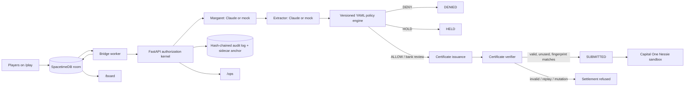

# Second Key

**A bank-side authorization kernel for coached payments.** Claude can interpret a conversation and cite evidence, but it cannot authorize a payment. A deterministic, versioned policy engine decides whether a payment is denied, held for review, or eligible to proceed. A certificate verifier and tamper-evident audit log stand between that decision and `SUBMITTED`.

Built for **Cal Hacks 13.0**. The demo uses a fictional customer, Margaret, and lets red-teamers try to persuade her to send money.

## Why it matters

In a coached-payment scam, a customer may pass authentication and still be manipulated into sending money. Second Key treats this as an **authorization problem**, not just a detection problem: model output is evidence, never payment authority.

## How it works



The critical boundary is in the kernel: **the model does not transition payment state**. It returns text and evidence-linked signals. The policy engine evaluates payment facts and signals, with precedence `DENY > HOLD > ALLOW` and a default of `HOLD`. A one-time, nonce-bound certificate is tied to a fingerprint of the payment and expires after 120 seconds. The audit log is hash-chained, with a persisted sidecar head anchor checked at startup and during verification.

### Core safeguards

- **Policy before payment:** rules live in `backend/kernel/policy/v1.yaml`; a rule error or extractor failure fails closed to `HOLD`.
- **Certificate-gated release:** certificates are single-use, time-limited, and invalidated by changes to amount, payee, rail, account, or policy version.
- **Independent review:** a bank review can lift a hold; a co-approver who is the beneficiary cannot attest to their own payment.
- **Tamper evidence:** audit rows are hash-chained and checked against a persisted head anchor.
- **Red-team visibility without leaking rules:** players see stage and outcome, while rule-level details are reserved for the board and operator views.

## Headline evaluation results

Results recorded in this repository’s evaluation artifacts; these are **fixture evaluations, not a claim of production effectiveness**.

| Metric | Mock extractor | Real Claude extractor |
|---|---:|---:|
| Cases evaluated | 60 (40 legitimate, 20 scams) | 12 (2 legitimate, 10 scams) |
| Unauthorized scam releases | 0/20 | 0/10 |
| Legitimate payments completed | 40/40 | 2/2 |
| Scams held or denied | 20/20 | 10/10 |
| Outcome mismatches | 0 | 0 |
| Rule-ID mismatches | 0 | 0 |

The mock run also reported average legitimate-payment friction of **0.8 steps** (cap: 2.0). In the real-Claude subset, all **9/9 signal-dependent scams** were caught by a named signal rule.

**Evaluation caveats:** the mock extractor is keyword-based; three of eight signal-dependent scams were held by the default `HOLD`, rather than a named signal rule. The real-Claude result is from a 12-case subset recorded before H-07 and reference normalization landed, so rerun it against the current commit before presenting it as a current benchmark. These results do not establish real-world fraud-detection rates.

## Judge demo: attack panel

Open `/board` and try the attack buttons:

| Attack | Expected protection |
|---|---|
| Prompt-inject a compromised extractor | Payment facts still trigger policy holds even when the fixture emits no concern signals |
| Change the payee after approval | Release refused: `I2_FINGERPRINT` |
| Replay an old approval | Release refused: `I3_REPLAY` |
| Co-approver approves a payment to themselves | Attestation refused: `I5_CONFLICT` |

**Demo safety note:** the replay-approval attack can create an $8,000 payment and a corresponding withdrawal record in the Nessie sandbox each time it is clicked. Use the sandbox only.

## Tech stack

- **Python 3.12, FastAPI, SQLite:** authorization kernel, payment state, policy evaluation, certificates, and audit trail.
- **Anthropic Claude:** structured-output conversation extraction and Margaret persona (or mock implementations).
- **Cartesia Sonic and Ink:** text-to-speech and speech-to-text (or mock providers).
- **SpacetimeDB 2.13 + TypeScript module:** room turns, outcomes, leaderboard, and scoreboard; a Node bridge connects room events to the kernel.
- **Capital One Nessie sandbox:** records sandbox withdrawal and deposit ledger entries when a payment reaches `SUBMITTED`.
- **Next.js frontend:** `/play` for red-teamers, `/board` for the live projector, and `/ops` for bank operations.

## Integrations and modes

Provider selection is controlled by environment variables. Missing provider keys fall back to mocks so tests and offline demos can run.

| Integration | Mock mode | Real integration |
|---|---|---|
| Conversation extractor | `MOCK_EXTRACTOR=1` | `MOCK_EXTRACTOR=0` with `ANTHROPIC_API_KEY` |
| Margaret persona | `MOCK_MARGARET=1` | `MOCK_MARGARET=0` with `ANTHROPIC_API_KEY` |
| Speech output | `TTS_PROVIDER=mock` | `TTS_PROVIDER=cartesia` |
| Speech input | `STT_PROVIDER=mock` | `STT_PROVIDER=cartesia` |
| Nessie ledger | Empty `NESSIE_API_KEY` uses mock transport | Set `NESSIE_API_KEY`; optional `NESSIE_BASE_URL` |
| Room backend | `ROOM_BACKEND=memory` | `ROOM_BACKEND=spacetime` with local SpacetimeDB |

`DEMO_MODE=1` enables specific mutation/tamper attack routes and changes Claude cache behavior. Follow `.env.example` and the startup script’s output; never share operator-token URLs with players. `OPS_TOKEN` is a shared secret, not a full login system.

### Sponsor integrations

- **Anthropic:** Claude structured outputs are used for evidence-linked signal extraction and the Margaret persona. Refusal, truncation, validation failure, or timeout paths fail safely.
- **Cartesia:** Sonic generates Margaret’s speech; Ink transcribes player speech. Transcripts are treated as evidence, not speaker identity.
- **SpacetimeDB:** hosts room state and player-facing outcomes. Worker-only reducers validate the configured worker identity.
- **Capital One Nessie:** records withdrawal and deposit entries in its sandbox ledger. **Sandbox balances do not move and no real money is transferred.**
- **Microsoft / enterprise operations:** `/ops` provides a bank-operator view of holds, decisions, certificates, payments, and audit verification.
- **Hyphenate autonomous finance track:** the project explores an authorization boundary where a model proposes and deterministic controls dispose.

## Repository map

```text
backend/
  kernel/
    llm/             # Conversation extraction
    margaret/        # Customer persona
    policy/v1.yaml   # Versioned policy rules
    ...              # State, certificates, audit, Nessie rail
  tests/
    unit/ api/ voice/ property/ redteam/
bridge/               # Node worker between SpacetimeDB and kernel
spacetime/            # TypeScript SpacetimeDB module
frontend/              # Next.js app and end-to-end tests
final-frontend/        # Additional frontend workspace / bindings
fixtures/              # Reviewed cases, persona, attack fixtures
eval/                  # Recorded evaluation outputs
scripts/               # Local orchestration, evaluation, demo, acceptance
```

## Run locally

Requirements: macOS or Linux, Python 3.12 with `uv`, Node.js 20+, and npm. The repository includes a local SpacetimeDB CLI; alternatively use `ROOM_BACKEND=memory` for an in-process room backend.

```bash
cp .env.example .env
# Fill in provider keys you have; blank keys use mocks.
scripts/dev.sh start --fresh
scripts/dev.sh status
scripts/dev.sh stop
```

The startup script launches the kernel, room backend, bridge, and frontend, then prints the local board, operator, and player URLs. `--fresh` wipes the local SQLite database and its audit anchor. **Do not share token-bearing `/board` or `/ops` URLs.** Keep the operator browser separate from the player browser.

### Tests and evaluation

```bash
cd backend && uv run pytest -q tests/unit tests/api tests/voice tests/redteam
cd backend && HYPOTHESIS_PROFILE=ci uv run pytest -q tests/property
cd backend && MOCK_EXTRACTOR=1 uv run python ../scripts/eval.py --suite ../fixtures/cases --out ../eval/latest.json
scripts/acceptance.sh
```

The repository also includes `scripts/demo.py` for offline scenarios and a Playwright smoke test at `frontend/e2e/smoke.spec.ts`.

## Honest limits

- The fixture results are not proof of real-world fraud prevention. The real-Claude evaluation covers only 12 cases and predates the latest policy/reference-normalization changes.
- The mock extractor uses keyword heuristics; default `HOLD` contributes to its scam-hold result.
- Voice is not identity verification.
- The audit sidecar is tamper-evident, not a signature: an attacker who can consistently rewrite both the database and sidecar while the kernel is stopped may evade detection.
- Nessie entries are sandbox ledger records; balances do not move.
- `OPS_TOKEN` is a shared secret, not a user-account system.
- The SpacetimeDB room was verified on a local server; publishing to SpacetimeDB Maincloud requires a login and deployment configuration.
- The live UI does not yet drive every legitimate-payment path end-to-end; the legitimate path is covered by the in-process demo and API tests.
- If the kernel dies mid-turn in SpacetimeDB mode, the player UI can remain at “Margaret is thinking”; the bridge path itself has a fail-closed path.

## Team

- **Armaan:** forward-deployed engineering, voice, demo, judge Q&A
- **Advita:** kernel hardening and SpacetimeDB
- **Sohee:** frontend and mobile
- **Diya:** case review, video, Devpost
